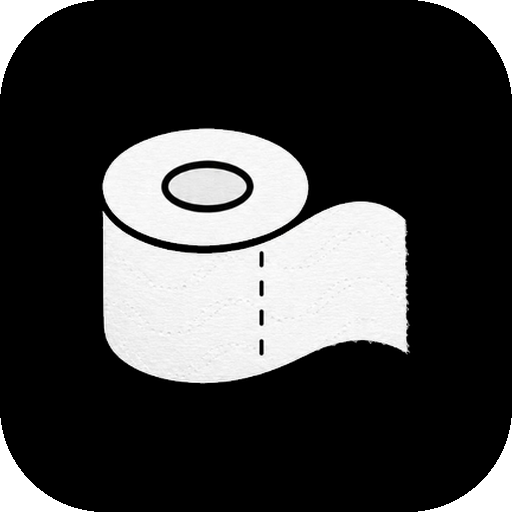

<!--markdownlint-disable MD013 MD033 MD041 -->
<div align="center">
  
  <h1>projekt_b-d</h1>

  <p>
    <a href="https://github.com/Asedwa/projekt_b-d/releases/latest">
      
    </a>
    
    
    
    <a href="#license">
      
    </a>
  </p>

  <br />

  <p>
    <a href="https://github.com/Asedwa/projekt_b-d/releases/latest">
      
    </a>
  </p>
</div>

Hey everyone! For a while I've been working on an open-source Android music player project out of personal need and curiosity, and now that it's ready to share, I wanted to post it here. It's called **projekt better deezer** (`projekt_b-d`).

In short, I wanted to bring local audio files on your phone and your Deezer library together in a single, clean, eye-friendly app that you can customize however you like. The UI is built with Kotlin and Jetpack Compose, while the core backend logic is written in Rust for high performance.

Here's what's inside:

- **Deezer + Local Music in one place:** Play your Deezer playlists, Flow, and mixes alongside the audio files stored on your device.
- **FLAC / MP3 Downloads:** Download tracks or entire playlists directly to your phone as MP3 or lossless FLAC for offline listening.
- **Jam (Listen Together):** Create a room code and listen to music in real-time sync with your friends.
- **Highly Customizable UI:** Reorder home screen cards and widgets with drag-and-drop. Includes AMOLED black mode, a custom theme editor, a translucent glass player that adapts to album artwork colors, and 12 animated live backgrounds.
- **Extra Tools:** Listening statistics, sleep timer, and private mode — all your data and stats stay 100% local on your device.

If you'd like to try it out, you can download the APK directly from [GitHub Releases](https://github.com/Asedwa/projekt_b-d/releases/latest). For future updates, you don't even need to revisit GitHub — you can check for and install new versions with a single tap right from the app's settings.

GitHub & APK Download: https://github.com/Asedwa/projekt_b-d

If you try it and have feedback like "this part could be better" or run into any bugs, feel free to share them in the comments or issues. Leaving a star on GitHub also motivates us a lot. Thanks to everyone who gives it a try!

## Building from Source

Requirements: JDK 17, Android SDK & NDK, Rust, and [`cargo-ndk`](https://github.com/bbqsrc/cargo-ndk).

```bash
git clone https://github.com/Asedwa/projekt_b-d.git
cd projekt_b-d/rust
cargo ndk -t arm64-v8a -t x86_64 -o ../android/app/src/main/jniLibs build -p android-ffi --release --locked
cd ../android
./gradlew :app:assembleRelease
```

The release APK is generated at `android/app/build/outputs/apk/release/app-release.apk`.

## License

This project is licensed under **GPL-3.0-or-later**.
